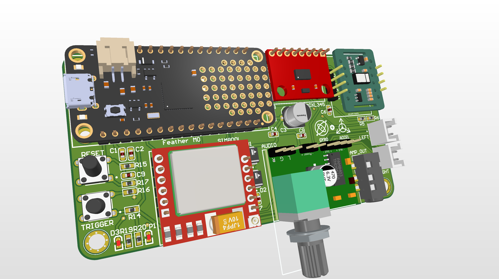
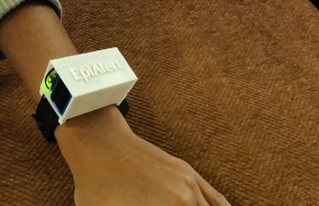
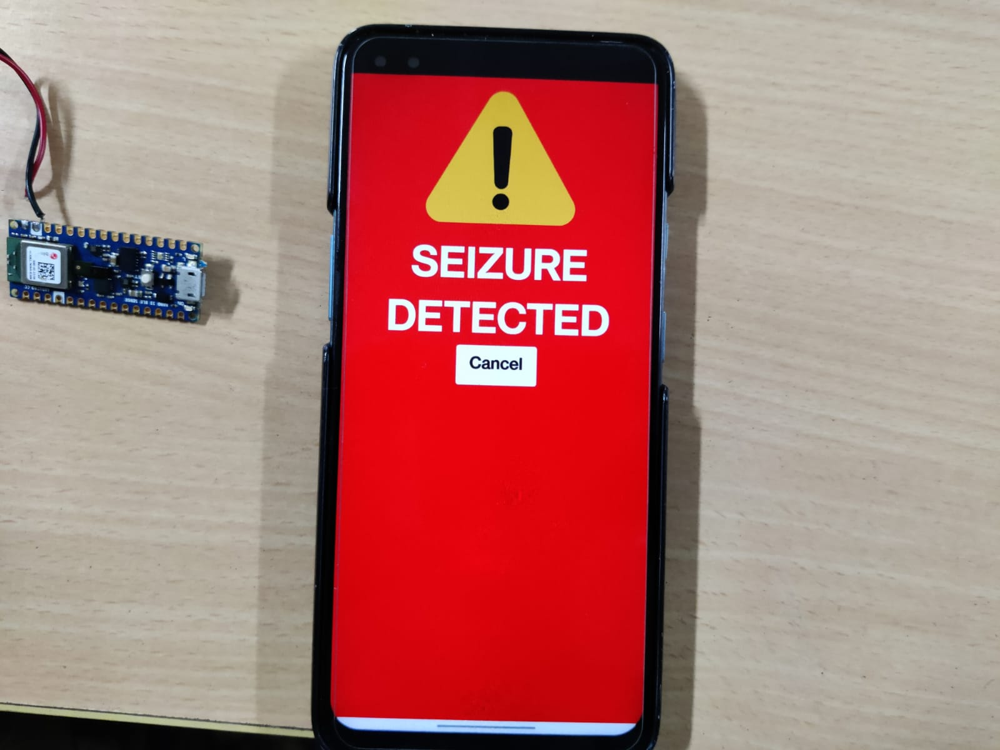

<p align="center">
  <h1 align="center">EpiAlert</h1>
  <p align="center"><strong>An Autonomous Multi-Centroid Hyperdimensional Computing Framework for Real-Time Seizure Detection on Wearable Edge Hardware</strong></p>
  <p align="center">
    <a href="https://github.com/SaianshT/EpiAlert/blob/main/docs/EpiAlert_Project_Overview.pdf"></a>
  </p>
  <p align="center">
    
    
    
    
  </p>
</p>

<p align="center">
  
</p>

> [!IMPORTANT]
> **Intellectual Property Notice:**  
> **UTILITY PATENT APPLICATION PUBLISHED, CURRENTLY UNDER EXAMINATION** (The Patent Office, Government of India).

---

## Problem & Motivation

Over **50 million individuals** worldwide live with epilepsy, enduring unpredicted seizures that frequently occur during sleep. In nocturnal settings, unwitnessed seizures dramatically increase the risk of physical trauma, status epilepticus, and **Sudden Unexpected Death in Epilepsy (SUDEP)**, where timely caregiver intervention is life-saving.

Commercial consumer smartwatches and clinical wearables present fatal vulnerabilities in daily ambulatory life:
1. **Fragile Smartphone Tethering:** Most wearables rely strictly on continuous Bluetooth pairing to a nearby smartphone. If the phone battery dies, Bluetooth disconnects, or the operating system suspends background tasks, alert delivery halts completely.
2. **Cloud Latency & Privacy Risks:** Offloading raw biosignals to cloud APIs introduces hazardous network latency precisely when seconds matter, alongside grave health-data privacy concerns.
3. **Prohibitive Cost & Form Factor:** Traditional clinical monitoring equipment remains bulky, non-ambulatory, and inaccessible to the vast majority of patients globally.

---

## Solution Overview

**EpiAlert** is an autonomous, low-cost, wrist-worn medical device engineered to deliver continuous seizure monitoring without smartphone tethering, Wi-Fi, or cloud processing. 

Equipped with a custom two-layer printed circuit board (55&times;55&times;20 mm), EpiAlert captures multimodal physiological signals (accelerometry, photoplethysmography/BVP, and clinical-grade skin temperature), processes them in real time using a **Multi-Centroid Hyperdimensional Computing (HDC)** edge model in **7.49 ms**, and autonomously initiates emergency SMS alerts and direct telephone voice calls to caregivers via an integrated quad-band GSM modem.

---

## Academic Mentorship

The biosignal feature engineering, embedded computing pipeline, and algorithm architecture were developed under the formal mentorship of:
- **Dr. Sachin Kumar B**, Professor at Centre for Biomedical Engineering (CBME), Indian Institute of Technology (IIT) Delhi
- **Dr. Biswarup Mukherjee**, Professor at Centre for Biomedical Engineering (CBME), Indian Institute of Technology (IIT) Delhi
- **Ritu Panda**, PhD Researcher at Ashoka University

---

## Evolution of Prototypes

EpiAlert underwent two distinct stages of hardware and computational engineering:

<table align="center" width="100%">
  <thead>
    <tr>
      <th width="20%">Architecture Layer</th>
      <th width="40%">Stage 1: Proof-of-Concept (2023–2024)</th>
      <th width="40%">Stage 2: Embedded Edge System (2025–2026)</th>
    </tr>
  </thead>
  <tbody>
    <tr>
      <td><strong>Microcontroller</strong></td>
      <td>Arduino Nano 33 BLE Sense (Nordic nRF52840 Cortex-M4)</td>
      <td>Adafruit Feather M0 (Microchip ATSAMD21G18 Cortex-M0+, 48 MHz)</td>
    </tr>
    <tr>
      <td><strong>Sensor Suite</strong></td>
      <td>LSM9DS1 integrated 9-axis IMU (Accelerometry only)</td>
      <td>Multimodal Array: ADXL345 (motion), MAX30102 (BVP/PPG), TMP117 (&plusmn;0.1&deg;C skin temp)</td>
    </tr>
    <tr>
      <td><strong>Hardware Build</strong></td>
      <td>Breadboard prototype transitioning to 3D-printed wristband enclosure</td>
      <td>Custom 55&times;55&times;20 mm integrated 2-layer PCB (Assembly, 3D, Schematic verified)</td>
    </tr>
    <tr>
      <td><strong>Algorithmic Engine</strong></td>
      <td>Edge Impulse neural net running in an Mbed OS background thread</td>
      <td>Multi-Centroid Hyperdimensional Computing (HDC) with patient-specific continuous learning</td>
    </tr>
    <tr>
      <td><strong>Alert Dispatch</strong></td>
      <td>Bluetooth Low Energy (BLE) peripheral service to companion mobile app</td>
      <td>Autonomous SIM800L GSM modem: direct cellular SMS text & voice calling dispatch</td>
    </tr>
    <tr>
      <td><strong>Infrastructure Reliance</strong></td>
      <td>Dependent on host smartphone proximity and active mobile application</td>
      <td><strong>100% Standalone</strong> &mdash; Zero smartphone, zero Wi-Fi, and zero cloud dependency</td>
    </tr>
  </tbody>
</table>

<p align="center">
  &nbsp;
  
</p>
<p align="center"><em>Left: Stage 1 3D-printed wearable wristband on wrist. Right: Stage 2 autonomous GSM emergency SMS alert delivered to caregiver mobile phone.</em></p>

---

## System Architecture

```text
[ Multimodal Biosensor Array ]
 ├── ADXL345 (3-Axis Accelerometry @ 32 Hz) ───────> ACC Jerk (strip gravity)
 ├── MAX30102 (Photoplethysmography / BVP) ────────> BVP Normalization (tachycardia)
 └── TMP117 (Clinical Skin Temperature) ───────────> Temperature Time-Derivative
                            │
                            ▼
[ ATSAMD21G18 ARM Cortex-M0+ Microcontroller ]
 ├── 4-Second Sliding Window Buffer (32 Hz)
 ├── Continuous Hypervector Encoder (Level & ID Hypervectors)
 ├── Multi-Centroid HDC Inference Engine (Hamming Distance XOR + Popcount)
 └── Online Adaptation Engine (Patient-Specific Incremental Sub-Centroids)
                            │
              (Ictal Classification Trigger)
                            ▼
[ Autonomous Emergency Dispatch ]
 ├── SIM800L Cellular Modem (Autonomous AT Command Sequence)
 ├── Caregiver Emergency SMS Dispatch (GPS coordinates & timestamp)
 ├── Immediate Caregiver Voice Call Ringing Sequence
 └── On-Board Transducer Alarm & Indicator LEDs
```

---

## Technical Approach: Multi-Centroid HDC

Standard deep-learning models (e.g., CNN-LSTMs) require extensive matrix-multiplication operations, high power consumption, and suffer from catastrophic forgetting when exposed to streaming data on embedded devices. EpiAlert adapts **Hyperdimensional Computing (HDC)** from Pale et al. (2022):

1. **Biosignal Feature Extraction:** Preprocesses raw 32 Hz windows by deriving **ACC-jerk** ($\frac{da}{dt}$) to isolate convulsive motions from gravitational orientation, normalizing Blood Volume Pulse to track sympathetic tachycardia, and computing temperature derivatives.
2. **Binary Hypervector Projection:** Projects continuous features into a 10,000-dimensional binary hypervector space ($\mathcal{H} \in \{0, 1\}^D$) through orthogonal level hypervectors and circular temporal shifts.
3. **Multi-Centroid Clustering:** Overcomes severe ambulatory class imbalance (1:1338) by dynamically creating discrete sub-centroids per patient, preventing massive non-seizure clusters from diluting sparse seizure events.
4. **Hardware-Native Inference:** Replaces floating-point matrix operations with bitwise XOR and hardware popcount instructions to calculate Hamming distances against learned centroids, executing in **7.49 ms**.

---

## Key Results & Benchmark Evaluation

All performance figures are factually grounded in formal experimental evaluations on retrospective clinical recordings:

- **Benchmark Dataset:** Evaluated across **2,622,950 4-second windows** recorded from **16 motor-seizure patients** in the *My Seizure Gauge* (MSG) dataset (Epilepsy Ecosystem), reflecting an ambulatory class imbalance of **1:1338** (seizure to non-seizure).
- **Baseline CNN-LSTM Comparison:** A benchmark 11-channel CNN-LSTM model achieved a mean AUC-ROC of only **56.8%** with drastic cross-fold variance (**27.7% to 80.4%**), illustrating severe failure in cross-patient generalization.
- **HDC Peak Performance:** Multi-Centroid HDC attained a peak localized detection performance of **68.9%** on individual subjects.
- **Patient-Specific Adaptation:** Implementing Leave-One-Subject-Out (LOSO) initialization followed by incremental sub-centroid addition elevated detection sensitivity for patient `MSEL_01870` from **2.5% to 98.7%**.
- **Embedded Hardware Profile:**
  - **Inference Latency:** **7.49 ms** on a 48 MHz ARM Cortex-M0+.
  - **Memory Footprint:** Uses only **15.6% of SRAM** (5.0 KB of 32 KB).
  - **Battery Life:** **~119 hours** operational life on a 3.7V 1200 mAh LiPo battery under standard duty cycling.

---

## Repository Structure

```text
EpiAlert/
├── docs/
│   └── EpiAlert_Project_Overview.pdf      # Complete 4-page formal technical overview
├── firmware/
│   ├── EpiAlert_FeatherM0_PCB.ino         # Latest PCB firmware (Sensors, GSM alert dispatch)
│   └── EpiAlert_Nano33BLE.ino             # Stage 1 firmware (IMU, BLE service, RTOS thread)
├── pcb/
│   ├── ASM_EpiAlert.pdf                   # Production PCB assembly drawing
│   ├── EpiAlert_3D.pdf                    # 3D layout visualization
│   └── SCH_EpiAlert.pdf                   # Complete electrical circuit schematic
├── ml/
│   └── README.md                          # Notice: Under active validation (source coming soon)
├── images/
│   ├── pcb_isometric.png                  # PCB CAD 3D isometric view
│   ├── pcb_top.png                        # PCB top layer layout
│   ├── wristband_v1.jpg                   # Stage 1 physical wristband prototype
│   ├── circuit_diagram.png                # Labeled hardware circuit schematic
│   ├── gsm_cellular_alert.jpg             # Caregiver cellular alert notification
│   └── hardware_breadboard.jpg            # Early hardware validation breadboard
└── README.md
```

> **Notice Regarding `ml/` (Source Code Availability):**  
> The Python Multi-Centroid Hyperdimensional Computing (HDC) training and continuous learning codebase, adapted from Pale et al. (2022), is still being validated, and will be published shortly.

---

## Author & Acknowledgements

- **Author:** Saiansh Tapuriah
- **Academic Mentors:** Dr. Sachin Kumar B (CBME, IIT Delhi), Dr. Biswarup Mukherjee (CBME, IIT Delhi), Ritu Panda (Ashoka University)
- **Data Acknowledgement:** The *My Seizure Gauge* (MSG) dataset provided through the Epilepsy Ecosystem.
